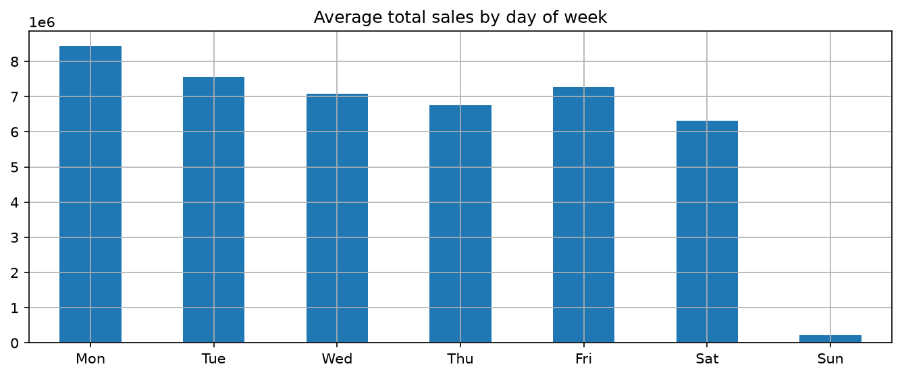
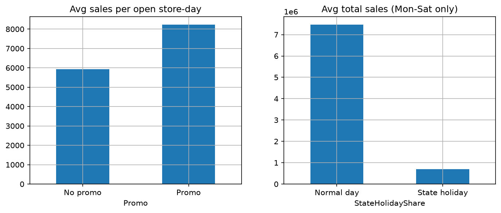
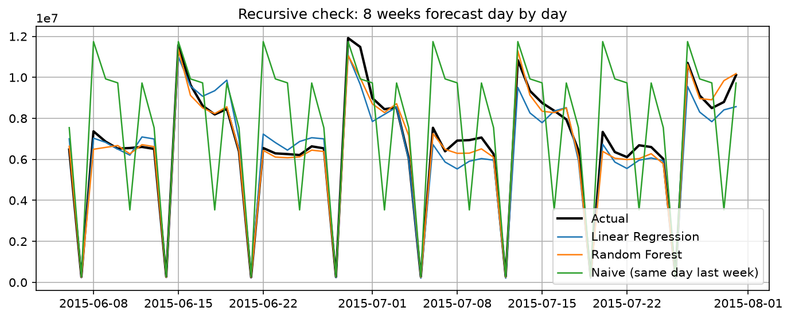
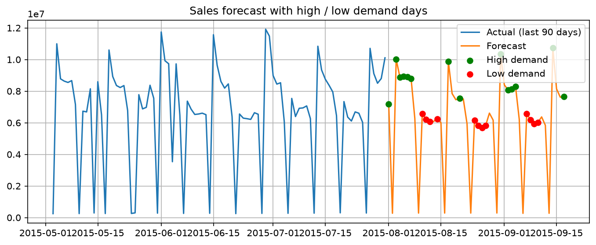

# Seasonal Sales Forecasting (Rossmann)

Forecasts total daily sales of the Rossmann drugstore chain and flags **high- and low-demand days**.
The main model is **Linear Regression with calendar features**, compared with a **Random Forest** and a naive baseline.

## What it does

- Builds one row per day (942 days, 2013-01-01 to 2015-07-31) from the store-level data.
- Creates calendar features (weekday, month, week of year), promo / holiday shares, and previous-sales features (lags of 7, 14, 28 days and a 7-day average).
- Uses a **chronological split**: the last 56 days (8 weeks) are the test set.
- Forecasts 48 future days (2015-08-01 to 2015-09-17) and labels each as High, Normal, Low or Sunday.

## Results

Lower is better. Test set: 2015-06-06 to 2015-07-31 (56 days).

**Test A: one-step-ahead.** Uses the real past sales as inputs.

| Model | MAE | RMSE |
|---|---|---|
| Random Forest | 311,396 | 450,914 |
| Linear Regression | 542,505 | 698,762 |
| Naive (same day last week) | 2,058,684 | 2,570,368 |

**Test B: recursive forecast (the realistic one).** The last 8 weeks are treated as unknown and forecast day by day, using the model's own predictions as inputs. This is how a real future forecast works.

| Model | MAE | RMSE |
|---|---|---|
| Random Forest | 300,787 | 438,508 |
| Linear Regression | 554,403 | 712,370 |
| Naive (same day last week) | 2,017,777 | 2,581,669 |

**Linear Regression vs Random Forest.** I tried both. The first version of Linear Regression had an MAE of 748,817 (2.4x worse than Random Forest). Using a log-sales target, scaled features and light Ridge regularisation cut that by about 27%. Random Forest is still better (about 1.7x lower MAE in Test A and 1.8x in Test B), so it is used for the final forecast. Both models beat the naive baseline by a wide margin. The naive baseline does badly because promotions run in alternating weeks, so "same day last week" is often the wrong promo state.

## Plots

**Weekly pattern**

**Promo and holiday effect**

**Realistic check: 8 weeks forecast day by day**

**Forecast with high / low demand days**

## Key findings

1. Promo weeks cause the high-demand days (promo lifts sales per open store-day by 39%), so staff and stock should be planned around the promo calendar.
2. Sunday sales are only about 3% of a normal Mon-Sat day because most stores are closed, so Sundays need minimal staffing.
3. State-holiday days are about 91% lower than normal Mon-Sat days, so large deliveries should not be scheduled for them.
4. December is the strongest month and October the weakest, so stock should be built up before December.

## How to run

1. Download the [Rossmann Store Sales](https://www.kaggle.com/c/rossmann-store-sales) data and put `train.csv` and `test.csv` in the `data/` folder.
2. Install the packages: `pip install -r requirements.txt`
3. Run from the project root: `python seasonal_forecast.py`

Outputs are saved in `reports/`: the plots, `model_comparison.csv`, `model_comparison_recursive.csv` and `seasonal_forecast.csv`.

## Limitations

- The forecast is for **total sales of all stores**, not per store.
- The 8-week test is one window, so the scores come from a single period.
- The future promo and holiday flags come from Kaggle's `test.csv`, which has no sales, so the Aug-Sep 2015 forecast cannot be scored.
- Only about 2.5 years of history are available, so the seasonal pattern rests on 2 to 3 observations per month.